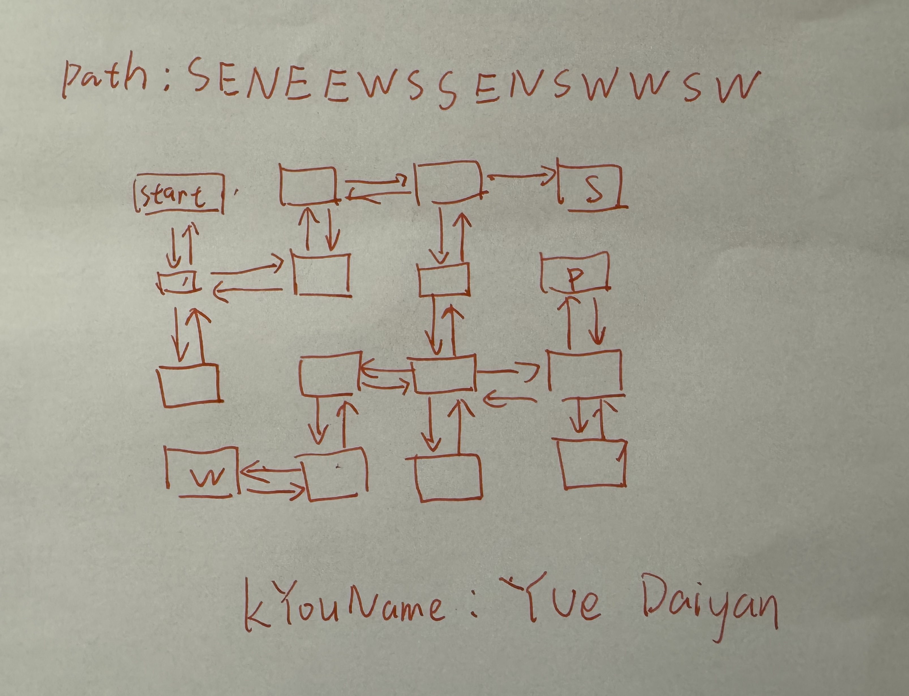
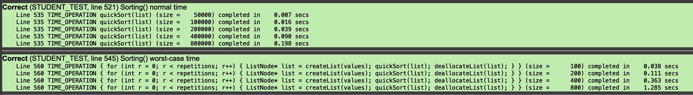
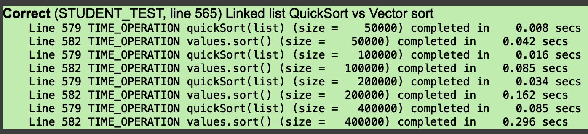
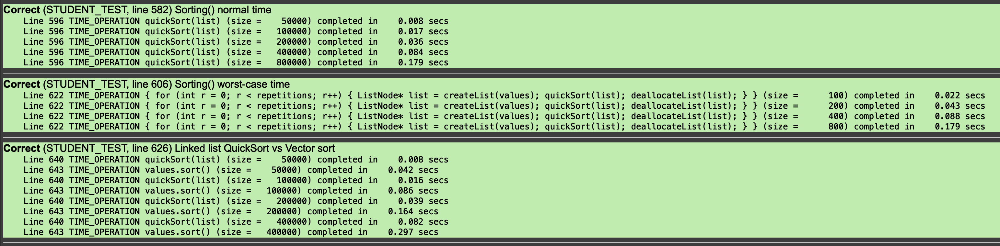

Before submitting this file, make sure that there are no more TODO
placeholders remaining in the file (and remove this comment too).

## Memory Debugging Warmup

Q1. What does the yellow background for a test case indicate in the SimpleTest result window?

```
A1.
程序在本次测试中正常执行，但是实际出现了内存泄漏.
```

Q2. What is the observed consequence of a test that uses `delete` on a memory address that has already been deallocated?

```
A2.
程序卡在了这一步,永远不会运行结束.
```

Q3. On your system, what is the observed consequence of `badDeallocate`? Under what circumstances (if any) did the buggy code trigger an error or crash?

```
A3.
在我的Mac上,这两个程序会直接卡死,我开关了一些其它的软件,并且多次尝试测试这两个案例,依旧是卡死的状态.
```

Q4. How is a segmentation fault presented on your system?

```
A4.
程序卡死,应用输出斯坦福库红色报错:段错误.
```

## Labyrinth

Q5. What is a different legal path through the example labyrinth that gathers all three needed items?

```
A5.
WNNEWSSEESNWSWWN
and etc.
```

**Escaping from your personal labyrinth**



## Sorting Linked Lists

Q6. If the `deallocateList` utility function were implemented recursively, give a rough estimate of the maximum length list it could successfully handle. What would be the observed result from attempting to deallocate a list longer than this maximum?

```
A6.
会导致栈溢出错误
```

Q7. The prototype for the sort function takes a `ListNode*` by reference. Explain why the pointer itself needs to be passed by reference and what the consequence would be if it were not.

```
A7.
这里要修改的是这个指针所指向队列中的元素顺序,自然需要索引传递.
如果使用拷贝传递,那么排序的结果会在函数结束后,自动丢弃.
```

Q8. Run time trials and provide your results that confirm that QuickSort is O(NlogN) . Verify the runtime degrades to O(N^2) on inputs constructed to trigger the worst case behavior.



Q9. Run the provided timing trials that compare your linked list QuickSort to a Vector sort on the same sequence and report the results. Who wins and why?



```
我的代码胜利了, 原因应该是: 我的代码在处理重复元素的时候具有优势.
同时，我的代码是基于链表的设计,不需要任何拷贝，一切都在指针层面处理.而std则是基于vector的设计,是确定类型之后的连续值,所以排序的时候需要拷贝值.
```

**Extensions**

添加智能取值函数:findBetterPivot();,解决O(N^2)的问题,尽可能让所有情况都贴近O(NlogN).


