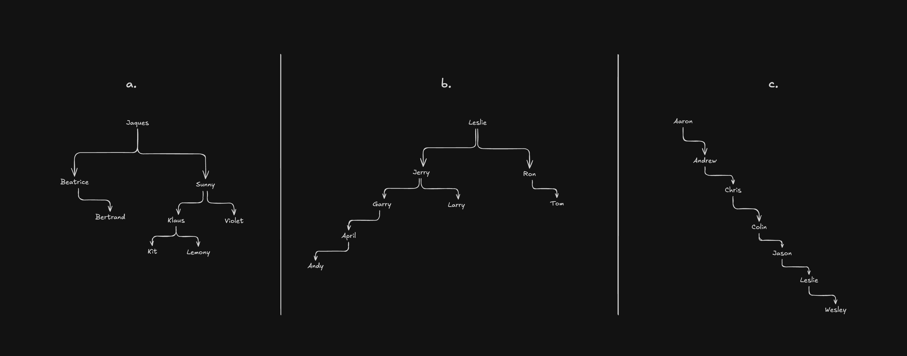
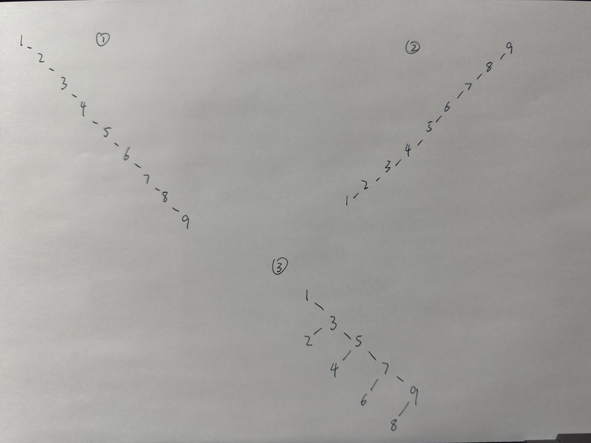
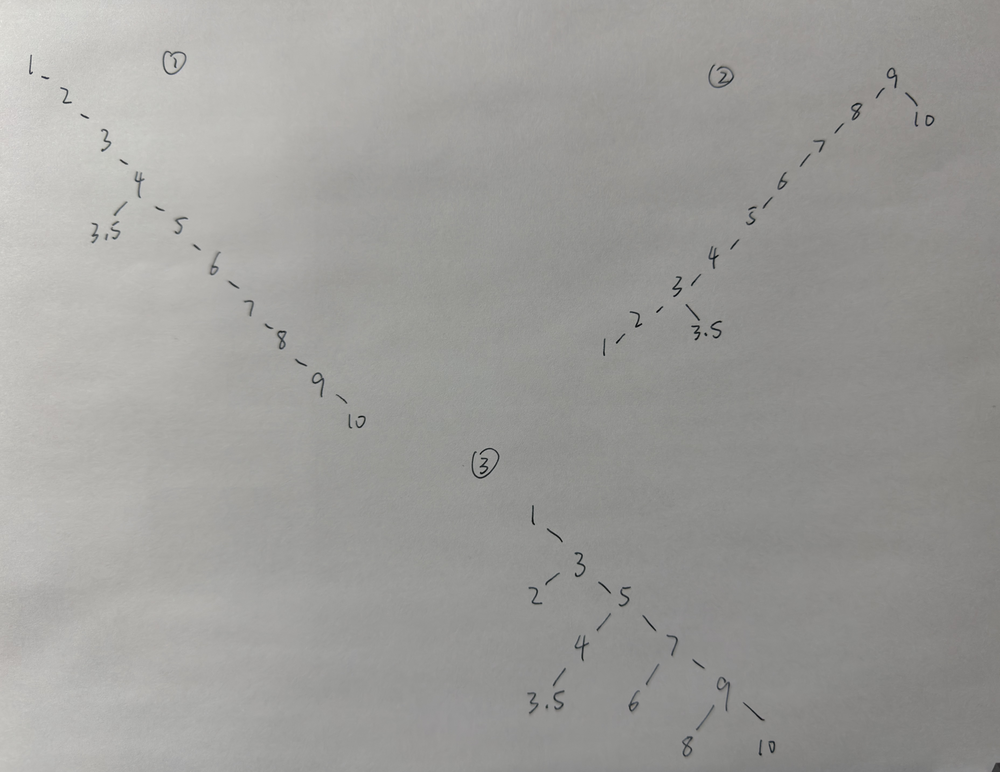

**1) No, You're Out of Order!**

| 遍历方式           | 顺序                       |
| ------------------ | -------------------------- |
| 前序（pre-order）  | 当前节点 → 左子树 → 右子树 |
| 中序（in-order）   | 左子树 → 当前节点 → 右子树 |
| 后序（post-order） | 左子树 → 右子树 → 当前节点 |

```txt
a) 3 5 1 2 4 6
a) 1 5 3 4 2 6
a) 1 5 4 6 2 3

b) 5 2 1 4 3 8 7 6 9
b) 1 2 3 4 5 6 7 8 9
b) 1 3 4 2 6 7 9 8 5

c) 2 1 7 4 3 5 6 9 8
c) 2 3 4 5 7 1 6 8 9
c) 3 5 4 7 8 9 6 1 2
```

```txt
b) is binary search tree.
```

**2) Binary Tree Insertion**



**3) Binary Search Tree Warmup**


Trace through the logic to insert the number 10 into that tree. Then insert 3.5.


**8) The Ultimate and Penultimate Values (findmax.cpp)**

```txt
all runs in O(height).
```
